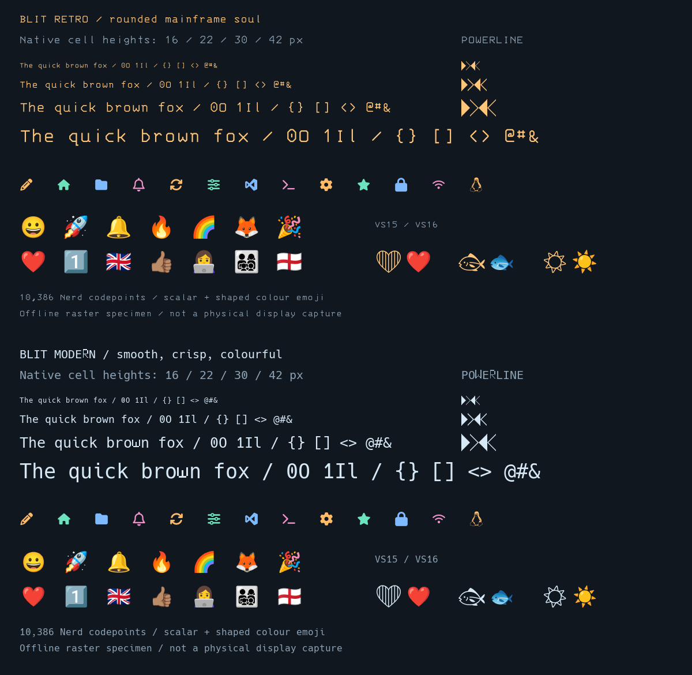

# Blit font and glyph developer reference

For Hibr application, desktop and Control Panel developers. This reference
describes the font set since Blit 0.2.36 (ADR 0195). Query the running
server for the fonts it found and the one selected. It does not require changes to Hibr core.

Public reference: [github.com/osakka/blit — font reference](https://github.com/osakka/blit/blob/main/docs/font-reference.md).

**Browse:** [every Nerd glyph by category](fonts/README.md),
[Blit/Hibr special additions](fonts/special.md),
[every pinned emoji by category](fonts/emoji.md),
[exact native font coverage](fonts/coverage.json).



The image is rendered by Blit's production rasterizer. Glyphs in the web
tables use your browser's fonts: a missing box or different colour there
does not describe Blit's rendering. Copy names/codepoints or JSON strings,
not a screenshot of a browser glyph.

## Families and sizing

**The font list is discovered,** not fixed:
- **Outline text fonts:** any regular, monospaced TTF or OTF in the fonts
  root's `text/` folder, plus `/usr/local/lib/blit/fonts/text` for your own.
- **Ids:** a font's id is its family name in kebab form, and its title is
  the family name.
- **`GET /v1/fonts`** lists `profiles` (with `title` and
  `source: shipped|local`) and `rejected` (with each reason).

The shipped text fonts are unmodified upstream releases:

| API id | Font | Licence |
| --- | --- | --- |
| `hack` | Hack 3.003 | MIT and Bitstream Vera |
| `ibm-3270` | IBM 3270 3.0.1 | BSD-3-Clause |
| `jetbrains-mono-nl` | JetBrains Mono NL 2.304 | OFL 1.1 |
| `fira-code` | Fira Code 6.2 | OFL 1.1 |
| `ibm-plex-mono` | IBM Plex Mono 1.1.0 | OFL 1.1 |
| `blit-terminus16`, `blit-spleen16` | Bitmap pixel fonts | OFL / BSD |

**Every outline font draws through one glyph stack.** For each character,
in order:
1. Blit's cell geometry: box drawing, blocks, Braille, Powerline and bar
   corners.
2. Blit's own icons.
3. The text font.
4. Nerd Fonts Symbols.
5. Noto Sans Symbols 2, Noto Sans Symbols and Noto Sans Math.
6. The emoji faces.
7. Blit Arabic Modern.
8. Unifont.

Stack glyphs are fitted to the chosen font at draw time, so every font has
every glyph, including one you add. Native grayscale antialiasing
rasterizes text at the requested size.

**The pixel fonts** (Blit Terminus 16 and Blit Spleen 16) draw every glyph
they have themselves, in their own pixels, box drawing included. The stack
supplies the rest: Blit's icons, Nerd icons, symbols, emoji and Unifont's
one-column coverage, fitted to the font's own H (ADR 0199). Wide characters
come from Blit's wide pixel font. Only a character no face has shows the
font's `?`.

`size_px` is **cell height8–64**, not point size, browser zoom or display
resolution. Read `active.cell_pixels` after changing it; never calculate
image placement from an assumed half-width cell. Resizing changes the grid
and attached PTYs. Do not change the user's font just to display one icon.
Original icons are fitted to text metrics, not stretched to fill every pixel
of a cell. Their ink bounds and terminal advance are different concepts.

## Choose the right category

| Need | Reference | Rendering/integration rule |
| --- | --- | --- |
| Ordinary text, punctuation and source-font scripts | [Native coverage](fonts/coverage.json) | Primary face plus established fallback; asset cmap is not a promise of script shaping |
| App actions, files, development, devices, weather, brands | [17 Nerd categories](fonts/README.md) |10,764 names/aliases,10,386 distinct scalars in both smooth profiles; uses terminal foreground colour |
| Branded Blit/Hibr menu icons, Wi-Fi1–4, Bluetooth | [Seven original colour additions](fonts/special.md) | Explicit semantic ID/private scalar, one cell, intrinsic palette |
| Themed Hibr pen, runic text, wired indicator | [Themed text additions](fonts/special.md#themed-text-additions) | U+270E, U+16D2, U+21CC retain documented text meanings |
| Powerline separators and box/block UI geometry | [Powerline](fonts/pl.md), [Extras](fonts/ple.md) | Core U+E0B0..E0B3 use cell-fitted geometry; do not extend that guarantee to every Extra; box/half-block geometry is protected |
| Arabic and Arabic-Indic digits | [Arabic section below](#arabic-and-arabic-indic-numerals) | Native companions, shared baseline, existing Hibr visual ordering |
| Faces, people, nature, food, objects, symbols, flags | [Emoji categories](fonts/emoji.md) | Colour/text presentation and multi-scalar layout are distinct from Nerd icons |

Nerd `custom-*` names belong to the pinned upstream Nerd catalogue; they are
**not** the new original Blit private-use namespace. Multiple names can map
to the same character. Use the complete name and pinned version when
resolving a Nerd symbol; do not infer a scalar from an icon's label.

## Special additions: the application contract

The authoritative mapping is [icons/catalogue.json](../assets/fonts/icons/catalogue.json),
also served unchanged by authenticated `GET /v1/fonts/icons`.
[The generated table](fonts/special.md) gives every ID, codepoint and valid
JSON escape. Keep application choices semantic: `hibr-pen`, `wifi-1` through
`wifi-4`, `bluetooth`, `blit`, `battery-0` through `battery-4`,
`battery-0-charging` through `battery-4-charging`, `battery-ac`, and
`volume-0` (muted) through `volume-3`, `power`, `phone-off`, `phone-wait`,
`phone-on`, `phone-ring`, their classic counterparts `phone-classic-off`
through `phone-classic-ring`, the large two-column version of each
(`phone-off-large-left` + `phone-off-large-right` and so on), and
`hui-left` + `hui-right`. Resolve those IDs from the catalogue
instead of maintaining an independently numbered table in every application.

**One icon says the whole state.** The charging bolt and the mains plug are
drawn inside the battery, so a status bar shows one glyph per state, never a
mark beside a level.

**A badge two columns wide is two codepoints.** Write `hui-left` then
`hui-right` side by side: each is one column, and each draws its half of
one badge (ADR 0197).

All 49 originals use **one terminal column** in every font.
They are plane16 private-use scalars, not standard Unicode, ordinary emoji,
or portable assignments in an unrelated font. In particular:

- U+270E `✎` is the themed pen silhouette; it is not the multicolour pen.
- U+16D2 `ᛒ` is Berkanan, not the new Bluetooth drawing.
- Four Wi-Fi entries represent signal levels1..4. No disconnected/unknown
  fifth state is defined; choose an explicit textual/themed fallback.
- Intrinsic-colour artwork keeps its palette; ordinary Nerd icons follow
  foreground colours. A truecolour terminal alone does not imply colour-font
  glyph support or these private mappings.

Use normal UTF-8 output. Do not send the visible text `U+100001`, treat a
supplementary character as two terminal cells, or append VS16 to a private
icon in an attempt to enable colour. JSON uses a surrogate pair for a
supplementary scalar; the generated table includes valid strings. For example,
U+100000 is `"\udbc0\udc00"`, not the invalid six-digit escape `"\u100000"`.

## Discover first; retain a fallback

Read-only discovery (the update credential is not needed):

```sh
curl --fail-with-body "$BLIT_URL/v1/fonts" \
  -H "Authorization: Bearer $BLIT_AUTH_TOKEN"
curl --fail-with-body "$BLIT_URL/v1/fonts/icons" \
  -H "Authorization: Bearer $BLIT_AUTH_TOKEN"
```

Recommended integration sequence:

1. Read the selected profile from `active.id`. The catalogue's `profiles`
   says which profiles support these originals; `available` on an inactive
   profile does not mean it is selected.
2. Fetch the catalogue, check `version`, and resolve the exact semantic ID.
   Parse hexadecimal `codepoint` into a Unicode scalar; emit UTF-8. Respect
   catalogue `columns` for these icons, not UTF-8 byte/UTF-16-unit length.
3. If the route is not Blit, the active font is unsupported, discovery fails
   or a version/ID is unknown, retain the application's Nerd/Unicode/ASCII
   fallback. Do not change the global font or equate terminal name with
   capability discovery.
4. Cache discovery for the connection, then invalidate after reconnect or a
   font/profile change. Do not poll the catalogue on every repaint.

`GET /v1/fonts/icons` returning503 `font_icon_catalogue_unavailable` is a
diagnostic condition, not an empty successful catalogue. A404 on an older
server means the client should retain its fallback. Future catalogue versions
must be checked, not assumed compatible.

For a language-independent implementation, the essential conversion is:

```python
entry = next(i for i in catalogue["icons"] if i["id"] == "hibr-pen")
character = chr(int(entry["codepoint"], 16))
# Write character as UTF-8 through the application's normal terminal path.
```

This illustrates scalar conversion, not a Hibr API or a replacement for its
UI/glyph abstraction. Internal Hibr tracking330 covers opt-in desktop
integration; that number is not a GitHub issue mapping. Merely installing the font does not
replace existing application icon selections. Hibr source is not modified
by this reference.

## Arabic and Arabic-Indic numerals

Both smooth profiles attach their required companion automatically. Inspect
`active.arabic_companion` for actual loaded family/path, shared `baseline_px`
and `shaping: "visual-cell-marks"`; bitmap profiles report null. Primary
`glyphs`/`mappings` counts describe PSF fallback, not total native coverage.

The requested Arabic-Indic/Hindi numerals are **`٠١٢٣٤٥٦٧٨٩`**, U+0660..0669.
They are separate from Western `0123456789`, U+0030..0039; Devanagari digits
are not the same set. Core specimens include `حِبْر`, vocalized Bismillah,
lam-alef variants, greetings and mixed numeral sets.

Hibr already emits visual-order presentation forms. Blit preserves their
cell allocation and uses OpenType cell-local mark positioning; **do not apply
a second bidi pass or reverse the text again**. Blit is not an implicit
paragraph bidi/shaping engine for arbitrary clients. Diacritics and joining
ink may extend beyond a cell while the advance remains unchanged.

[View the actual shared-raster Arabic specimen](images/blit-arabic-candidates.png).
The [captured logical/visual corpus](../assets/fonts/arabic-specimens.json)
is finite; neither the corpus nor raw companion cmap coverage guarantees all
Arabic, Quranic annotations or religious ligatures. The corpus's original
acceptance annotations are historical; current implementation evidence is in
the [verification ledger](verification-status.md) and [ADR0174](adr/0174-arabic-companion-rasterization.md).

## Emoji: characters, presentation and sequences

The [complete categorized reference](fonts/emoji.md) lists all5,244 pinned
Emoji18.0 test entries:3,972 RGI entries plus1,272 qualification variants.
Each row includes the complete scalar sequence, JSON string and qualification,
not just its first visible character. Group and subgroup names come from
the Unicode corpus, not a second Blit classification system.

Noto Color Emoji2.057 supplies intrinsic colour; Noto Emoji3.002 supplies
text-presentation outlines. VS15 U+FE0E requests text and VS16 U+FE0F requests
emoji presentation for supported sequences. ZWJ, modifiers, regional-indicator
flags, keycaps and tags are multi-scalar clusters, not individual Nerd glyphs.

Scalar layout remains the compatibility default. An application deliberately
using cluster layout must follow the [explicit emoji layout API](api.md#explicit-emoji-cell-layout-offline-candidate578),
including owner/continuation cells and width. Do not switch the existing Hibr
desktop's layout policy globally to make an icon work. Font/corpus coverage,
browser appearance and passing local raster tests are not universal terminal
or physical conformance guarantees; internal tracking110 covers remaining
acceptance. See the [font plan](font-evolution-plan.md).

## Machine-readable sources and reproducibility

- [Original icon catalogue](../assets/fonts/icons/catalogue.json): stable
  semantic IDs, profile compatibility, one-cell allocation and signal levels;
  served by the existing discovery endpoint.
- [Pinned Nerd glyph names](../assets/fonts/nerd-glyphnames-v3.4.0.json): all
  names, aliases, scalar hex and UTF-8 characters; not a new HTTP endpoint.
- [Generated native coverage](fonts/coverage.json): exact SHA256 and inclusive
  scalar ranges from each native font's best Unicode cmap. This is asset
  coverage, not runtime routing, fallback, ink or shaping conformance.
- [Font provenance](../assets/fonts/fonts.source.json),
  [Arabic provenance](../assets/fonts/arabic-fonts.source.json),
  [Emoji corpus](../assets/unicode/emoji-18.0/source.json), and
  [Hibr UI snapshot](../assets/fonts/hibr-ui-glyphs.json). The latter is a
  versioned101-scalar snapshot, not every application.

The tables are generated, not another editable glyph registry:

```sh
# Use the same isolated fontTools4.60.1 environment as the font builders.
python3 tools/fonts/build-reference.py
python3 tools/fonts/build-reference.py --check
ruby tools/tests/font_reference_gate.rb
```

The generator verifies pinned input hashes, and that the glyph stack covers
the full Nerd catalogue and the original icons. Regenerate and commit derived tables together
when canonical assets change. No host fonts, network or running display are
needed. Repository Markdown on [GitHub](https://github.com/osakka/blit) is the
public publication format. Use repository-relative file links within the
guide and GitHub `blob/main` URLs when sharing it externally. Internal Gitea
addresses are for engineering workflow, not public publication. A future
site should consume the same files rather than introduce a parallel catalogue.

## Licences and attribution

Keep [font notices](../assets/fonts/README.md), [Nerd family attribution](../assets/fonts/licenses/nerd-v3.4.0/README.md),
[original-art MIT licence](../assets/fonts/icons/LICENSE.txt), and
[Unicode data licence](../assets/unicode/emoji-18.0/LICENSE.txt) when redistributing
the respective material. Each text font's licence is in `licenses/`. Arabic
Modern is GPLv3+ with the documented font-embedding exception and preferred
source included; Unifont is used under the OFL 1.1.
Typeface, source-art and trademark rights are distinct. Inclusion of a brand
glyph does not grant permission to use its trademark.
