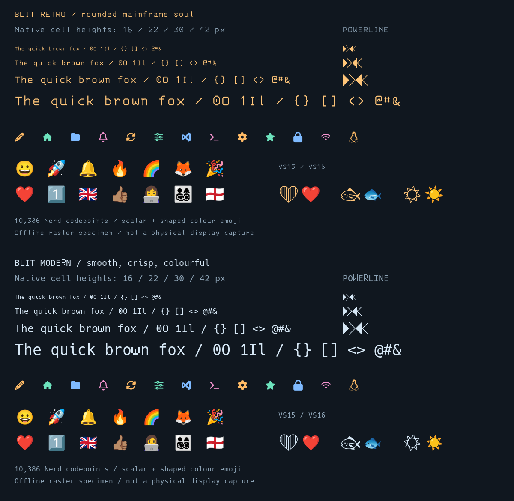

# Blit font and glyph developer reference

For Hibr application, desktop and Control Panel developers. This reference
describes the font set since Blit 0.2.36 (ADR 0195). Query the running
server for the fonts it found and the one selected. Nothing here needs a
change to Hibr core.

Public reference: [github.com/osakka/blit — font reference](https://github.com/osakka/blit/blob/main/docs/font-reference.md).

**Browse:** [every Nerd glyph by category](fonts/README.md),
[Blit/Hibr special additions](fonts/special.md),
[every pinned emoji by category](fonts/emoji.md),
[exact native font coverage](fonts/coverage.json).



The image is rendered by Blit's production rasterizer. Glyphs in the web
tables use your browser's fonts: a missing box or different colour there
does not describe Blit's rendering. Copy names/codepoints or JSON strings,
not a screenshot of a browser glyph.

## Families and sizing

**The font list is discovered,** not fixed:
- **Outline text fonts:** any regular, monospaced TTF or OTF in the fonts
  root's `text/` folder, plus `/usr/local/lib/blit/fonts/text` for your own.
- **Ids:** a font's id is its family name in kebab form, and its title is
  the family name.
- **`GET /v1/fonts`** lists `profiles` (with `title` and
  `source: shipped|local`) and `rejected` (with each reason).

The shipped text fonts are unmodified upstream releases:

| API id | Font | Licence |
| --- | --- | --- |
| `hack` | Hack 3.003 | MIT and Bitstream Vera |
| `ibm-3270` | IBM 3270 3.0.1 | BSD-3-Clause |
| `jetbrains-mono-nl` | JetBrains Mono NL 2.304 | OFL 1.1 |
| `fira-code` | Fira Code 6.2 | OFL 1.1 |
| `ibm-plex-mono` | IBM Plex Mono 1.1.0 | OFL 1.1 |
| `blit-terminus16`, `blit-spleen16` | Bitmap pixel fonts | OFL / BSD |

**Every outline font draws through one glyph stack.** Arabic letters go
to Blit Arabic Modern. Every other character takes the first of these that
has it:
1. Blit's cell geometry: box drawing, blocks, Braille, Powerline, bar
   corners and the window-chrome glyph sets.
2. Blit's own colour icons.
3. Colour emoji, for emoji presentation.
4. Nerd Fonts Symbols, for a private-use codepoint, whatever the text font
   puts there.
5. The text font.
6. Blit's monochrome text glyphs (the themed pen, runic text, wired
   indicator).
7. Nerd Fonts Symbols, for anything else.
8. Text-presentation emoji, where asked for.
9. Noto Sans Symbols 2, Noto Sans Symbols and Noto Sans Math.
10. Unifont.

Stack glyphs are fitted to the chosen font at draw time, so every font has
every glyph, including one you add. Native grayscale antialiasing
rasterizes text at the requested size.

**The pixel fonts** (Blit Terminus 16 and Blit Spleen 16) draw every glyph
they have themselves, in their own pixels, box drawing included. The stack
supplies the rest: Blit's icons, Nerd icons, symbols, emoji and Unifont's
one-column coverage, fitted to the font's own H (ADR 0199). Wide characters
come from Blit's wide pixel font. Only a character no face has shows the
font's `?`.

`size_px` is **cell height, 8 to 64**, not point size, browser zoom or display
resolution. Read `active.cell_pixels` after changing it; never calculate
image placement from an assumed half-width cell. Resizing changes the grid
and attached PTYs. Do not change the user's font just to display one icon.
Original icons are fitted to text metrics, not stretched to fill every pixel
of a cell. Their ink bounds and terminal advance are different concepts.

## Choose the right category

| Need | Reference | Rendering/integration rule |
| --- | --- | --- |
| Ordinary text, punctuation and source-font scripts | [Native coverage](fonts/coverage.json) | Primary face plus established fallback; asset cmap is not a promise of script shaping |
| App actions, files, development, devices, weather, brands | [17 Nerd categories](fonts/README.md) | 10,764 names/aliases, 10,386 distinct scalars, under every font; uses terminal foreground colour |
| Branded Blit/Hibr menu icons, Wi-Fi 1–4, Bluetooth | [Original colour additions](fonts/special.md) | Explicit semantic ID/private scalar, one cell, intrinsic palette |
| Themed Hibr pen, runic text, wired indicator | [Themed text additions](fonts/special.md#themed-text-additions) | U+270E, U+16D2, U+21CC retain documented text meanings |
| Window chrome: title bars, frames, dialogs, buttons (Chalk, Slate light, Slate dark) | [Cell geometry](fonts/special.md#cell-geometry), [below](#window-chrome-glyph-sets-chalk-and-slate) | Pixel-exact cell geometry; Chalk in the foreground, Slate in its own colours; label buttons with SGR 51 |
| Powerline separators and box/block UI geometry | [Powerline](fonts/pl.md), [Extras](fonts/ple.md) | Core U+E0B0..E0B3 use cell-fitted geometry; do not extend that guarantee to every Extra; box/half-block geometry is protected |
| Arabic and Arabic-Indic digits | [Arabic section below](#arabic-and-arabic-indic-numerals) | Native companions, shared baseline, existing Hibr visual ordering |
| Faces, people, nature, food, objects, symbols, flags | [Emoji categories](fonts/emoji.md) | Colour/text presentation and multi-scalar layout are distinct from Nerd icons |

Nerd `custom-*` names belong to the pinned upstream Nerd catalogue; they are
**not** the new original Blit private-use namespace. Multiple names can map
to the same character. Use the complete name and pinned version when
resolving a Nerd symbol; do not infer a scalar from an icon's label.

## Special additions: the application contract

The authoritative mapping is [icons/catalogue.json](../assets/fonts/icons/catalogue.json),
also served unchanged by authenticated `GET /v1/fonts/icons`.
[The generated table](fonts/special.md) gives every ID, codepoint and valid
JSON escape. Keep application choices semantic: `hibr-pen`, `wifi-1` through
`wifi-4`, `bluetooth`, `blit`, `battery-0` through `battery-4`,
`battery-0-charging` through `battery-4-charging`, `battery-ac`, and
`volume-0` (muted) through `volume-3`, `power`, `phone-off`, `phone-wait`,
`phone-on`, `phone-ring`, their classic counterparts `phone-classic-off`
through `phone-classic-ring`, the file
icons (`file-<kind>-<colour>-left` + `-right`, ADR 0201), and `hui-left` +
`hui-right`. Resolve those IDs from the catalogue
instead of maintaining an independently numbered table in every application.

**One icon says the whole state.** The charging bolt and the mains plug are
drawn inside the battery, so a status bar shows one glyph per state, never a
mark beside a level.

**A badge two columns wide is two codepoints.** Write `hui-left` then
`hui-right` side by side: each is one column, and each draws its half of
one badge (ADR 0197).

Icons and symbols are fitted to the cell at every size from 8 to 64 px
without trimming (ADR 0215): a colour icon is fitted by the layers it draws
(so the Wi-Fi bars and the volume waves, not just their first layer), a
spanning icon is drawn unhinted so its halves join, and a glyph that cannot
be fitted is shown as the fallback, never cut.

Every original uses **one terminal column** in every font.
They are plane 16 private-use scalars, not standard Unicode, ordinary emoji,
or portable assignments in an unrelated font. In particular:

- U+270E `✎` is the themed pen silhouette; it is not the multicolour pen.
- U+16D2 `ᛒ` is Berkanan, not the new Bluetooth drawing.
- Four Wi-Fi entries represent signal levels 1 to 4. No disconnected/unknown
  fifth state is defined; choose an explicit textual/themed fallback.
- Intrinsic-colour artwork keeps its palette; ordinary Nerd icons follow
  foreground colours. A truecolour terminal alone does not imply colour-font
  glyph support or these private mappings.

Use normal UTF-8 output. Do not send the visible text `U+100001`, treat a
supplementary character as two terminal cells, or append VS16 to a private
icon in an attempt to enable colour. JSON uses a surrogate pair for a
supplementary scalar; the generated table includes valid strings. For example,
U+100000 is `"\udbc0\udc00"`, not the invalid six-digit escape `"\u100000"`.

## Window chrome glyph sets: Chalk and Slate

ADR 0210 and 0211. 70 glyphs at U+100231–100276 draw retro Mac-style
window chrome out of cells. They are two sets of 35 in one order (Chalk,
Slate), listed in the catalogue's `cell_geometry` section as
`chalk-<name>` and `slate-light-<name>`. U+100277–100299, once Slate dark,
are retired.
- **A set per part.** Each part (title bar, frame, dialog border, button
  ends) takes its glyphs from whichever set the application picks for it,
  so the sets mix: a Slate title bar on a box-drawing frame, a Chalk title
  bar on a Slate frame. Every set has the same geometry, so parts from
  different sets meet at the same rows and columns.
- **Chalk** is one colour: the cell's foreground over its background, so a
  theme recolours it.
- **Slate** is the same geometry in the cell's pens. Each pixel is one of:
  - **the foreground:** lines and outlines;
  - **the underline colour (SGR 58, white if unset):** the bar's
    highlights, box faces, and a dialog's and a button's face;
  - **half the foreground and half the background, each channel:** the
    stripes and shades;
  - **the cell's background:** the bar.
  One set therefore serves light and dark schemes alike. The Pewter
  scheme (bar 214, ink black, SGR 58 white) draws 0.3.38's Slate light
  except for those half-and-half pixels.
- **The background shows wherever a glyph draws nothing.** On a held
  desktop that is the wallpaper, right up to the frame's line.
- **No shadow in the glyphs.** The frame and dialog pieces draw only their
  lines and borders, so `frame-right-top` draws as `frame-right` and
  `frame-bottom-first` as `frame-bottom`; both keep their codepoints. A
  drop shadow is SGR 66, which Blit draws under any glyph (see [the
  terminal reference](terminal.md#sgr)).
- They are pixel-designed for an 11x22 cell. At every size, lines,
  stripes and SGR 51 are 1 px, the dialog border's layers are 2/3/1/1 px
  and the default ring is 3 px. The boxes stay as wide as the cell, the
  stripes keep their proportion of the bar and a button's ends their
  roundness. Neighbouring cells always join.
- **A title** is text on the bar's background, framed to match the bar.
  Chalk uses SGR 51, which draws the frame line and the rule. Slate uses
  SGR 51:2, which also draws the bar's highlight and shade rows in the
  cell's pens. `stripe-before-title` and `stripe-after-title` stand either
  side.
- **A button** is `button-left`, the label with SGR 51 on the button's
  face, and `button-right`. A default button is `default-button-left`, the
  label with SGR 51:3, and `default-button-right`. Set the label's SGR 58
  to the ring's colour (the foreground of the caps). Slate's caps sit on
  the dialog's face (their background), with SGR 58 set to the button's
  face, which they paint inside the ring: the corners outside the ring
  show the dialog's face. The shade down and right is half the foreground
  and half that face. Chalk's caps and label share one background.
- **A dialog** is the `dialog-*` border round its content cells.
  - **Slate:** the frame cells keep the wallpaper as their background and
    set SGR 58 to the dialog's face, which the margin and gap paint. The
    3 px line is solid foreground. Nothing is drawn beyond the 7 px
    border, so there is no halo.
  - **Chalk,** being one colour, leaves its margin and gap transparent,
    so its frame cells take the dialog's face as background and the face
    shows round the border. For a black-and-white dialog with no halo, use
    the Slate glyphs with a black foreground and SGR 58 white.

## Window frame: one frame, its line on the outer edge

ADR 0214. 13 glyphs at U+1002AE–1002BA are the window frame as the owner
wants it: **one frame, and its line sits on the outermost edge of each
frame cell** (the left cell's left edge, the right cell's right edge, the
bottom row's bottom edge). Nothing else in the cell is drawn, so the cell's
own background is the padding: set the frame cells' background to the
window's face and the face runs out to the line.

| Glyph | Codepoint | Put it | Pens |
| --- | --- | --- | --- |
| `frame-left` | U+1002AE | left of each body row | fg = the line |
| `frame-right` | U+1002AF | right of each body row | fg = the line |
| `frame-bottom-left` | U+1002B0 | bottom-left corner (left and bottom lines) | fg = the line |
| `frame-bottom` | U+1002B1 | the bottom row | fg = the line |
| `frame-bottom-right` | U+1002B2 | bottom-right corner (right and bottom lines) | fg = the line |
| `chalk-title-end-left`, `-right` | U+1002B3, U+1002B4 | the title row's end cells | fg = the ink, bg = the bar |
| `slate-light-title-end-left`, `-right` | U+1002B5, U+1002B6 | the title row's end cells | bg = the bar, fg = the ink, SGR 58 = the highlight |
| `chalk-title-end-plain-left`, `-right` | U+1002B7, U+1002B8 | the inactive title row's end cells (no stripes) | fg = the ink, bg = the bar |
| `slate-light-title-end-plain-left`, `-right` | U+1002B9, U+1002BA | the inactive title row's end cells (no stripes) | bg = the bar, fg = the ink, SGR 58 = the highlight |

- **One frame set.** Chalk's and Slate's frame glyphs were the same 1 px
  foreground line, so the frame cells are one set (catalogue `set: frame`,
  coverage in the foreground). The right-hand cell of the title row is not
  `frame-right`: it is a title-end glyph.
- **A title-end cell is the title bar's end.** It carries the outer line, the
  bar's top line and rule (Slate: its bevel rows too), and **the stripes run
  into it**, starting (left) or stopping (right) 2 px from the cell's outer
  edge: the line and one clear pixel. They join the next cell's stripes at
  every cell size. Chalk's are coverage; Slate's use the cell's pens as the
  Slate bar glyphs do. The **plain** title ends (0.3.45) are the same cells
  without stripes, for the inactive bar: they sit beside the plain `title`
  cells and join them at every size. `stripe-first` and `stripe-last` are redundant.
- **The shadow is unchanged** (SGR 66, ADR 0211), but goes in the cells
  beyond the frame cells with **inset 0** (`66:kind:width:0`), so its strip
  begins at the pixel next to the frame's line.
- **Deprecated, not retired.** The window sets' `frame-left`,
  `frame-right-top`, `frame-right`, `frame-bottom-left`,
  `frame-bottom-first`, `frame-bottom`, `frame-bottom-right`, and
  `stripe-first`, `stripe-last` (Chalk and Slate: 18 glyphs) are marked
  `deprecated: true` with `replaced_by` in the catalogue and in
  [the special-glyph table](fonts/special.md). Blit still draws them,
  unchanged, until a later release retires them. The dialog, note and
  `frame-top-*` glyphs are not affected.

## Pressed boxes and the grow box

ADR 0219. 10 glyphs at U+1002BB–1002C4, five a set, Chalk's then Slate's:
the title bar's three boxes **pressed**, and the window's **grow box** (the
resize corner), normal and pressed.

| Glyph | Codepoint | Put it | Pens |
| --- | --- | --- | --- |
| `chalk-close-pressed`, `-shade-pressed`, `-zoom-pressed` | U+1002BB–1002BD | in place of `chalk-close`, `-shade`, `-zoom` while the box is pressed or hovered | fg = the ink, bg = the bar |
| `chalk-grow`, `chalk-grow-pressed` | U+1002BE, U+1002BF | the window's bottom-right cell, in place of `frame-bottom-right` | fg = the ink, bg = the window's face |
| `slate-light-close-pressed`, `-shade-pressed`, `-zoom-pressed` | U+1002C0–1002C2 | in place of `slate-light-close`, `-shade`, `-zoom` | bg = the bar, fg = the ink, SGR 58 = the highlight |
| `slate-light-grow`, `slate-light-grow-pressed` | U+1002C3, U+1002C4 | the window's bottom-right cell | bg = the window's face, fg = the ink, SGR 58 = the highlight |

- **Hover is pressed.** There is one set of states: draw the pressed glyph
  for a box the pointer is over or holding, the normal one otherwise.
- **Chalk pressed** is the box solid in the foreground with its mark cleared
  out, so the cell's background shows through it: close an X (7x7 at 11 px),
  zoom a square outline (6x6, one clear pixel inside the border, in the
  top-left), shade three bars (box rows 3, 5 and 7).
- **Slate pressed** is the mix pen inside the box, the unpressed bevel
  inverted (the foreground pen on the inner top and left, the line pen on the
  inner bottom and right), and the mark in the foreground pen, about 5 px.
- **The grow box** is an 11x11 square at the bottom of the cell (rows 11–21
  at 11x22). Its right and bottom edges are the frame's own outer lines, so
  the cell is the bottom-right corner of the frame (ADR 0214) with the box
  in it: put it where `frame-bottom-right` goes. Inside, a `/` hatch with a
  4 px period. Chalk: black lines. Slate: each a mix-pen line with a
  line-pen line beside it. Pressed (dragging): Chalk is solid with the hatch
  cleared out, Slate the mix pen with a foreground hatch.
- At other cell sizes the box is the title bar's box (the band's square) and
  the marks and hatch keep their pixel widths.

## Controls: checkbox, switch and capsule

ADR 0212. 20 glyphs at U+10029A–1002AD draw controls out of cells, in the
same roles as the window chrome, listed in the catalogue's `cell_geometry`
section. The next free codepoint is U+1002C5 (the outer-edge frame, below,
is U+1002AE–1002BA, and the pressed boxes and grow box U+1002BB–1002C4).
- **Checkbox,** one cell: an 11x11 square on the text row (as the window
  boxes), in Chalk and Slate, off, on and mixed (`chalk-check-off`, `-on`,
  `-mixed`; `slate-check-*`). Chalk: a plain 1 px square, an X when checked,
  a dash when mixed. Slate: an outline, a face (SGR 58), a shade down and
  right (the mean of foreground and background), a 2 px check mark, a
  heavier dash.
- **Compact switch,** two cells wide (22x11), written side by side: left
  then right, off and on, in Chalk and Slate (`chalk-switch-off-left`,
  `-off-right`, `-on-left`, `-on-right`; `slate-switch-*`). Chalk: a ring
  and a solid knob on the left when off, a solid track with an empty knob on
  the right when on. Slate: a bevelled track with a knob in SGR 58, a mixed
  grey track when on.
- **Capsule switch,** three cells wide (33x22), left, middle and right, off
  and on (`capsule-off-left`, `-off-mid`, `-off-right`, `-on-*`). It has no
  outline and no colour of its own: the track is the cell's **foreground**
  (green when on, grey when off: the application chooses), the knob SGR 58
  (white), the smoothed edge the mean of the foreground and background.
  It scales with the cell's height; the checkbox and switch scale as the
  window boxes do. At a 4x8 cell the checkbox's *on* and *mixed* are the
  same pixel.
- **Pens to set,** for every cell-geometry glyph, are in the catalogue as
  data (`part`, `cells`, `background`, `foreground`, `line`) and described in
  [the icon contract](../assets/fonts/icons/README.md): a control's cells sit
  on the panel; Slate's checkbox sets SGR 58 to its face, its switch to the
  knob; the capsule sets the foreground to the track's colour and SGR 58
  white.

## Discover first; retain a fallback

Read-only discovery (the update credential is not needed):

```sh
curl --fail-with-body "$BLIT_URL/v1/fonts" \
  -H "Authorization: Bearer $BLIT_AUTH_TOKEN"
curl --fail-with-body "$BLIT_URL/v1/fonts/icons" \
  -H "Authorization: Bearer $BLIT_AUTH_TOKEN"
```

Recommended integration sequence:

1. Read the selected font from `active.id`. The catalogue's `profiles` is
   `["*"]`: the originals come from the glyph stack, so every font has them.
   `available` on an inactive profile does not mean it is selected.
2. Fetch the catalogue, check `version`, and resolve the exact semantic ID.
   Parse hexadecimal `codepoint` into a Unicode scalar; emit UTF-8. Respect
   catalogue `columns` for these icons, not UTF-8 byte/UTF-16-unit length.
3. If the route is not Blit, the active font is unsupported, discovery fails
   or a version/ID is unknown, retain the application's Nerd/Unicode/ASCII
   fallback. Do not change the global font or equate terminal name with
   capability discovery.
4. Cache discovery for the connection, then invalidate after reconnect or a
   font/profile change. Do not poll the catalogue on every repaint.

`GET /v1/fonts/icons` returning 503 `font_icon_catalogue_unavailable` is a
diagnostic condition, not an empty successful catalogue. A 404 on an older
server means the client should retain its fallback. Future catalogue versions
must be checked, not assumed compatible.

For a language-independent implementation, the essential conversion is:

```python
entry = next(i for i in catalogue["icons"] if i["id"] == "hibr-pen")
character = chr(int(entry["codepoint"], 16))
# Write character as UTF-8 through the application's normal terminal path.
```

This illustrates scalar conversion, not a Hibr API or a replacement for its
UI/glyph abstraction. Installing the font does not change the icons an
application already chooses.

## Arabic and Arabic-Indic numerals

Every outline text font attaches the one Arabic companion, Blit Arabic
Modern, automatically. Inspect `active.arabic_companion` for the loaded
family/path, shared `baseline_px` and `shaping: "visual-cell-marks"`; each
profile reports `arabic_companion_path`. Both are null for the pixel fonts.
Primary `glyphs`/`mappings` counts describe the PSF fallback, not total
coverage.

The requested Arabic-Indic/Hindi numerals are **`٠١٢٣٤٥٦٧٨٩`**, U+0660..0669.
They are separate from Western `0123456789`, U+0030..0039; Devanagari digits
are not the same set. Core specimens include `حِبْر`, vocalized Bismillah,
lam-alef variants, greetings and mixed numeral sets.

Hibr already emits visual-order presentation forms. Blit preserves their
cell allocation and uses OpenType cell-local mark positioning; **do not apply
a second bidi pass or reverse the text again**. Blit is not an implicit
paragraph bidi/shaping engine for arbitrary clients. Diacritics and joining
ink may extend beyond a cell while the advance remains unchanged.

[View the actual shared-raster Arabic specimen](images/blit-arabic-candidates.png).
The [captured logical/visual corpus](../assets/fonts/arabic-specimens.json)
is finite; neither the corpus nor raw companion cmap coverage guarantees all
Arabic, Quranic annotations or religious ligatures. The corpus's original
acceptance annotations are historical; current implementation evidence is in
the [verification ledger](verification-status.md) and [ADR 0174](adr/0174-arabic-companion-rasterization.md).

## Emoji: characters, presentation and sequences

The [complete categorized reference](fonts/emoji.md) lists all 5,244 pinned
Emoji 18.0 test entries: 3,972 RGI entries plus 1,272 qualification variants.
Each row includes the complete scalar sequence, JSON string and qualification,
not just its first visible character. Group and subgroup names come from
the Unicode corpus, not a second Blit classification system.

Noto Color Emoji 2.057 supplies intrinsic colour; Noto Emoji 3.002 supplies
text-presentation outlines. VS15 U+FE0E requests text and VS16 U+FE0F requests
emoji presentation for supported sequences. ZWJ, modifiers, regional-indicator
flags, keycaps and tags are multi-scalar clusters, not individual Nerd glyphs.

Scalar layout remains the compatibility default. An application deliberately
using cluster layout must follow the [explicit emoji layout API](api.md#explicit-emoji-cell-layout-since-01578),
including owner/continuation cells and width. Do not switch the existing Hibr
desktop's layout policy globally to make an icon work. Font/corpus coverage,
browser appearance and passing local raster tests are not universal terminal
or physical conformance guarantees; internal issue #110 tracks the rest.

## Machine-readable sources and reproducibility

- [Original icon catalogue](../assets/fonts/icons/catalogue.json): stable
  semantic IDs, profile compatibility, one-cell allocation and signal levels;
  served by the existing discovery endpoint.
- [Pinned Nerd glyph names](../assets/fonts/nerd-glyphnames-v3.4.0.json): all
  names, aliases, scalar hex and UTF-8 characters; not a new HTTP endpoint.
- [Generated native coverage](fonts/coverage.json): exact SHA256 and inclusive
  scalar ranges from each native font's best Unicode cmap. This is asset
  coverage, not runtime routing, fallback, ink or shaping conformance.
- [Font provenance](../assets/fonts/fonts.source.json),
  [Arabic provenance](../assets/fonts/arabic-fonts.source.json),
  [Emoji corpus](../assets/unicode/emoji-18.0/source.json), and
  [Hibr UI snapshot](../assets/fonts/hibr-ui-glyphs.json). The latter is a
  versioned 101-scalar snapshot, not every application.

The tables are generated, not another editable glyph registry:

```sh
# Use the same isolated fontTools 4.60.1 environment as the font builders.
python3 tools/fonts/build-reference.py
python3 tools/fonts/build-reference.py --check
ruby tools/tests/font_reference_gate.rb
```

The generator verifies pinned input hashes, and that the glyph stack covers
the full Nerd catalogue and the original icons. Regenerate and commit
derived tables together when canonical assets change. No host fonts, network or running display are
needed. Repository Markdown on [GitHub](https://github.com/osakka/blit) is the
public publication format. Use repository-relative file links within the
guide and GitHub `blob/main` URLs when sharing it externally. Internal Gitea
addresses are for engineering workflow, not public publication. A future
site should consume the same files rather than introduce a parallel catalogue.

## Licences and attribution

Keep [font notices](../assets/fonts/README.md), [Nerd family attribution](../assets/fonts/licenses/nerd-v3.4.0/README.md),
[original-art MIT licence](../assets/fonts/icons/LICENSE.txt), and
[Unicode data licence](../assets/unicode/emoji-18.0/LICENSE.txt) when redistributing
the respective material. Each text font's licence is in `licenses/`. Arabic
Modern is GPLv3+ with the documented font-embedding exception and preferred
source included; Unifont is used under the OFL 1.1.
Typeface, source-art and trademark rights are distinct. Inclusion of a brand
glyph does not grant permission to use its trademark.
